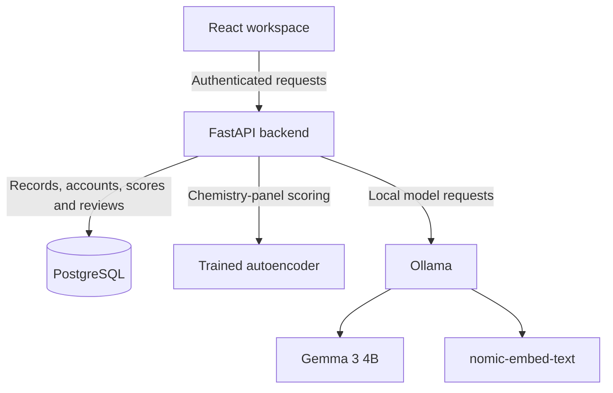
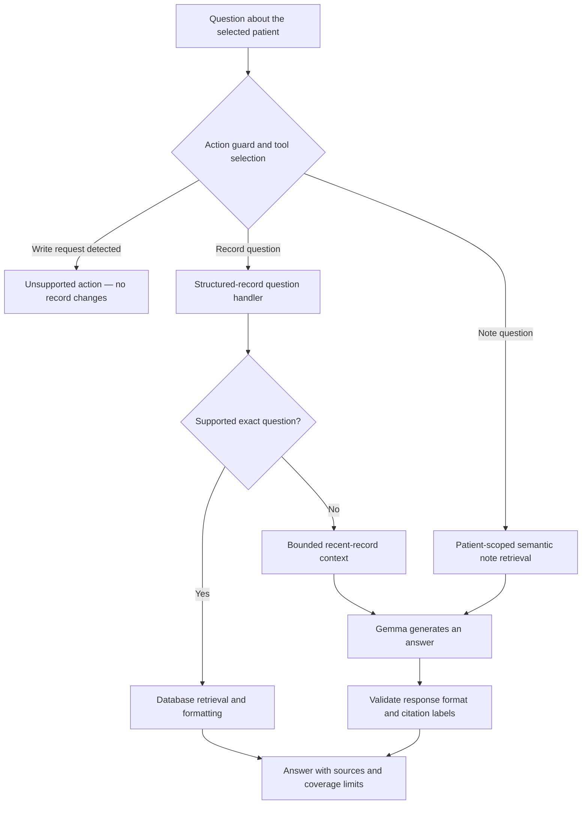
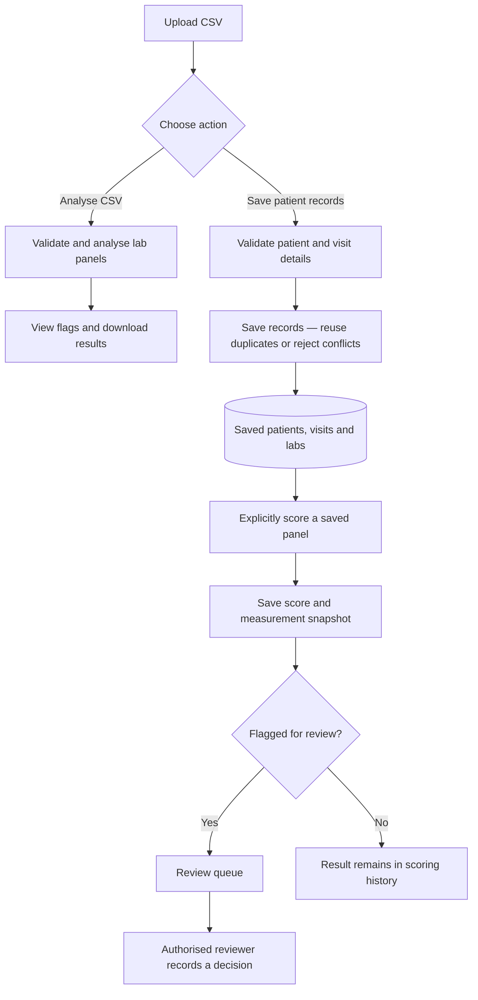

# IntelliCDM
### AI-Assisted Clinical Data Management and Analytics

IntelliCDM is an academic research prototype combining patient records,
laboratory measurements, anomaly detection and source-linked AI assistance
in one workspace.

**Author:** Hardik Pateriya  
**Institution:** Jaypee University of Engineering and Technology  
**Programme:** B.Tech Computer Science and Engineering

> Built and evaluated using synthetic data. This project is not clinically
> validated and must not be used for diagnosis or treatment.

## Features

- Patient registration and search by name or medical record number.
- Patient visits, notes and laboratory measurements.
- Complete eight-measurement chemistry-panel entry.
- CSV validation, anomaly analysis and patient-record import.
- Duplicate reuse and conflict rejection during CSV import.
- Saved anomaly scores with original measurement snapshots.
- Review queue and attributed, append-only review decisions.
- Patient summaries and questions with supporting sources.
- Semantic search over patient notes.
- Laboratory trends grouped by measurement unit.
- A bounded, read-only AI workflow selecting one answering tool.
- Role-based access for administrators, doctors and reviewers.
- Dashboard and React interface.

## Technology

| Component | Implementation |
|---|---|
| Frontend | React, TypeScript, Vite |
| Backend | Python, FastAPI, Pydantic |
| Database | PostgreSQL, SQLAlchemy, Alembic |
| Authentication | JWT tokens and Argon2 password hashing |
| Primary anomaly model | PyTorch autoencoder |
| Comparison baseline | Isolation Forest |
| Local language model | Gemma 3 4B through Ollama |
| Note embeddings | nomic-embed-text through Ollama |
| Synthetic records | Synthea |

## System architecture



Isolation Forest is an evaluation baseline. It is not the primary model
used by the current panel-scoring endpoint.

## How the AI is used

### Trained anomaly detection

An autoencoder learns patterns in eight laboratory measurements:

| Measurement | Input unit |
|---|---|
| Glucose | mg/dL |
| Creatinine | mg/dL |
| Urea nitrogen | mg/dL |
| Sodium | mmol/L |
| Potassium | mmol/L |
| Chloride | mmol/L |
| Calcium | mg/dL |
| Total carbon dioxide | mmol/L |

The current scoring method uses the largest adjusted per-feature
reconstruction error. A score above the configured threshold flags the
panel for review. Explicit data-quality rules can also trigger a flag.

The autoencoder and Isolation Forest baseline were trained for this project.

An anomaly score is not a disease probability. The feature with the largest
reconstruction discrepancy is not necessarily an incorrect measurement.

### Local language-model assistance

Pretrained Gemma 3 4B generates summaries and answers using retrieved
records. Gemma was integrated locally, not trained or fine-tuned as part
of this project.

Supported exact-value, measurement-list, status and trend questions use
database retrieval and templates to preserve saved values.

### Semantic note retrieval

The pretrained nomic-embed-text model produces embeddings for note search.
Relevant chunks are retrieved within the selected patient records and
provided to Gemma with source references.

Citation checks verify that referenced labels exist. They do not
automatically prove that every generated claim is supported.

## AI question workflow



The bounded agent executes at most one answering tool. Its tools are
read-only, and generated answers retain their unverified status.

## Training data

The main Synthea population and prepared dataset contained:

| Measure | Count |
|---|---:|
| Synthetic patient records | 2,271 |
| Observation rows | 1,789,749 |
| Selected chemistry observations | 168,424 |
| Complete panels after preparation | 20,904 |
| Patients with complete panels | 1,040 |

Patients were separated across training, validation and test sets.

| Split | Panels | Patients |
|---|---:|---:|
| Training | 14,557 | 728 |
| Validation | 3,468 | 156 |
| Test | 2,879 | 156 |

The autoencoder had 5,580 trainable parameters and ran for 150 epochs.
Recorded training time was approximately 40 seconds on an Apple M4 using MPS.
Training duration depends on hardware, configuration and dataset size.

## Evaluation

Evaluation included synthetic value corruptions, comparison with
Isolation Forest and a separate final generated population.

The final population contained 592 patients. Of these, 292 had complete
panels, yielding 5,853 evaluated panels.

Selected version-2 results from the final corruption experiment:

| Simulated change | Equal-patient detection rate |
|---|---:|
| Urea nitrogen divided by 10 | 93.4% |
| Creatinine multiplied by 10 | 59.4% |
| Creatinine divided by 10 | 1.2% |

These rates describe the defined corruption experiment on common eligible
panels. They are not clinical accuracy estimates.

A separate 120-panel demonstration CSV contained 20 baseline panels and
100 deliberately altered panels. The combined model and data-quality rules
flagged 96 altered panels and none of the 20 baseline panels.

This small constructed demonstration is not an independent clinical benchmark.

## Patient records and human review

1. Register a patient or import supported patient records from CSV.
2. Open a visit and inspect its laboratory measurements.
3. Explicitly score an eligible chemistry panel.
4. Inspect the saved score and its original measurement snapshot.
5. Record a review decision against that specific saved result.

CSV analysis alone does not save patient records. The separate
**Save patient records** action imports supported patient, visit and lab data.

Importing records does not automatically create scoring history or
review-queue entries.



A flag requests review; it does not confirm a data error or diagnosis.
Each review applies to its specific saved scoring result.

## Repository structure

```text
backend/
  app/                 API routes, models and application services
  migrations/          Database migrations
  ml/                  Preparation, training and evaluation scripts
  scripts/             Integration and verification scripts
  requirements.txt

frontend/
  src/                 React components and styles
  public/              Static assets
  package.json
```

## Running an existing configured workspace

The development environment uses Python 3.12, PostgreSQL 16, Node.js/npm
and Ollama.

Run the backend in one terminal, starting from the repository root:

```bash
conda activate intellicdm
cd backend
alembic upgrade head
uvicorn app.main:app --reload --port 8000
```

Run the frontend in another terminal, starting from the repository root:

```bash
cd frontend
npm ci
npm run dev
```

Ollama must be running. Download the models if they are not already installed:

```bash
ollama pull gemma3:4b
ollama pull nomic-embed-text
```

| Service | Development address |
|---|---|
| Frontend | http://127.0.0.1:5173 |
| API documentation | http://127.0.0.1:8000/docs |
| Backend health | http://127.0.0.1:8000/health |

### Fresh-clone requirements

The startup commands above assume an already configured workspace.

A fresh clone additionally requires:

- A Python environment with backend and ML dependencies.
- A local PostgreSQL database.
- A private backend `.env` file containing `DATABASE_URL` and a randomly
  generated `AUTH_SECRET` of at least 32 characters.
- Database migrations and initial administrator provisioning.
- Compatible trained model artifacts and scoring metadata for ML features.
- Local Ollama model downloads.

Datasets, trained artifacts, credentials, database contents and local
backups are intentionally excluded from this repository.

Cloning the repository alone does not reproduce the populated demonstration
environment. Training and evaluation scripts are provided under `backend/ml`;
their data paths and artifact requirements must be satisfied.

## Verification

Development checks have covered:

- Authentication and role restrictions.
- Input validation and unknown-record handling.
- Atomic chemistry-panel entry and duplicate rejection.
- Exact measurement values, units, timestamps and patient associations.
- Encounter-date filtering and missing-information handling.
- Patient-scoped semantic retrieval.
- CSV duplicate reuse and conflict rejection.
- Preservation of review history.

Some integration scripts create synthetic test records and leave them
saved. Inspect scripts before running them against an existing database.

Passing API checks does not establish clinical reliability or exhaustive
browser coverage.

## Current limitations

- Evaluation uses synthetic data only.
- Creatinine divide-by-10 corruptions were poorly detected in the recorded
  experiment.
- Generated summaries and answers can contain errors and require review.
- Retrieval has explicit encounter and lab-row limits.
- Laboratory units are not automatically converted.
- Missing reference ranges cannot establish whether a value is in range.
- Review attribution identifies an authenticated account, not independently
  verified professional credentials.
- Email invitations and password recovery are unfinished. Database fields
  have been prepared, but email delivery and reset flows are not enabled.
- The application is a local academic prototype, not a production-ready
  hospital system.

## Data and credentials

Do not commit `.env` files, passwords, tokens, patient exports or database
backups. Use synthetic data when demonstrating this repository.
